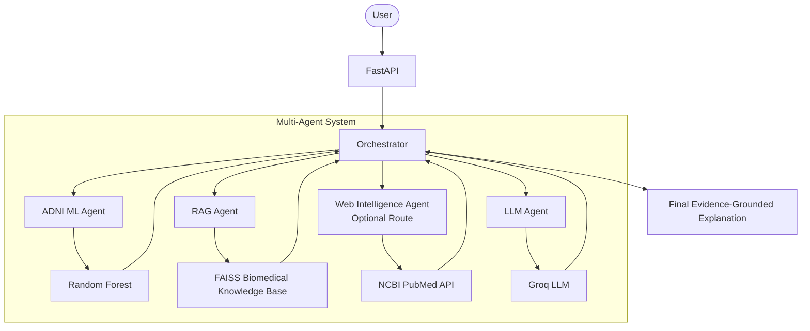

# HealthSense AI

This is the development environment and backend structure for HealthSense AI.

## Setup

1. Create a virtual environment:
   ```bash
   python -m venv venv
   ```
2. Activate the virtual environment:
   - Windows: `.\venv\Scripts\activate`
   - Linux/Mac: `source venv/bin/activate`
3. Install dependencies:
   ```bash
   pip install -r requirements.txt
   ```
4. Configure environment variables in `.env`.
5. Run the application locally:
   ```bash
   cd backend
   uvicorn main:app --reload
   ```

## ADNI Machine Learning Prediction

The backend integrates a pre-trained Random Forest model for Alzheimer's Disease National Initiative (ADNI) clinical data prediction.

**Classification:**
The model predicts one of three classes:
- `CN` (Cognitively Normal)
- `MCI` (Mild Cognitive Impairment)
- `AD` (Alzheimer's Disease) - *Note: The operational mapping was Dementia -> AD.*

**Input Features:**
The model uses exactly 10 features:
- `AGE`
- `EDUCATION`
- `ADAS`
- `CDR`
- `FAQ`
- `MMSE`
- `MOCA` (Note: MOCA has a ~58% missingness limitation in the dataset, handled automatically via imputation)
- `SEX`
- `RACE`
- `ETHNICITY`

**Model Performance:**
- Test Accuracy: 94.38%
- Test Macro F1: 92.30%
- AD F1: 82.93%
- AD Recall: 82.93%
- ROC-AUC Macro: 98.94%

**API Endpoint:**
`POST /api/adni/predict`

**Limitations:**
This model is a research prototype classifier and NOT a clinical diagnostic system. It must not be used to provide medical diagnoses.

---

## Multi-Agent Architecture

HealthSense AI uses an **orchestrator-based multi-agent architecture** where a central Supervisor routes each request to the appropriate agents and assembles a unified structured response.

### Why modular?

- **Separation of concerns** — each agent owns exactly one responsibility (ML prediction, retrieval, synthesis, etc.).
- **Pluggability** — new agents are added by implementing `BaseAgent` and registering them in the Orchestrator without touching existing agents.
- **Single model load** — the `ADNIPredictor` (and any future model) is loaded once at startup and injected into agents; no agent loads a model file independently.
- **Deterministic routing now, LLM routing later** — the `_select_agents()` hook is deliberately isolated so it can be swapped for LLM-based routing in a future phase without changing any agent code.

### Current implemented flow (Phase 5)

```
User
  ↓
POST /api/agents/analyze
  ↓
Orchestrator
  ↓
ADNI ML Agent
  ↓
ADNIPredictor (shared, loaded once at startup)
  ↓
Random Forest (models/adni_model.joblib)
  ↓
CN / MCI / AD + probabilities
  ↓
Orchestrator assembles AgentAnalysisResponse
  ↓
Structured JSON response
```

### Agent files

| File | Purpose |
|---|---|
| `backend/agents/state.py` | Pydantic state models: `AgentState`, `AgentResult`, `AgentAnalysisResponse` |
| `backend/agents/base_agent.py` | Abstract `BaseAgent` interface |
| `backend/agents/adni_agent.py` | `ADNIMLAgent` — wraps existing `ADNIPredictor` |
| `backend/agents/orchestrator.py` | `Orchestrator` — routing + response assembly |
| `backend/api/agents.py` | FastAPI router for `POST /api/agents/analyze` |

### API endpoints

| Method | Path | Description |
|---|---|---|
| `GET` | `/health` | Health check |
| `POST` | `/api/adni/predict` | Direct ADNI ML prediction (Phase 4) |
| `POST` | `/api/agents/analyze` | Multi-agent ADNI analysis (Phase 5) |

### Future planned agents *(NOT YET IMPLEMENTED)*

> ⚠️ The following agents are **planned** for future phases. They do not exist in the current codebase.

- [x] **Phase 5: Multi-Agent Foundation:** Introduction of `BaseAgent`, `ADNIMLAgent`, `AgentState`, and Orchestrator.
- [x] **Phase 6: Biomedical RAG (Alzheimer's):** FAISS Vector Store, chunking, and PyMuPDF ingestion for localized evidence.
- [x] **Phase 7: Groq LLM & Clinical Synthesis:** `LLMAgent` synthesizes RF prediction with RAG evidence into a grounded explanation.
- [x] **Phase 8: Web Intelligence Agent:** `WebIntelligenceAgent` queries NCBI PubMed E-utilities for real-time external clinical guidelines based on an adaptive orchestrator.
- [x] **Phase 9: Frontend Architecture (React):** React + Vite dashboard displaying the complete multi-agent workflow, RAG evidence, and predictions.
- [ ] **Phase 10: Parkinson's Integration:** Implementation of Parkinson's Disease tracking (Strictly on hold).

### Starting the backend

```bash
# From the project root (with venv activated)
uvicorn backend.main:app --reload
```

### Running all tests

```bash
pytest tests/ -v
```

---

## Biomedical RAG (Phase 6)

HealthSense AI includes a biomedical Retrieval-Augmented Generation (RAG) pipeline that retrieves relevant evidence from a curated knowledge base of Alzheimer's research papers and clinical guidelines.

### How it works

```
Biomedical PDFs (Alzheimer's only)
  ↓
Text extraction (PyMuPDF)
  ↓
Cleaning & chunking (400 words, 80 overlap)
  ↓
Embedding (sentence-transformers/all-MiniLM-L6-v2, 384-dim)
  ↓
FAISS IndexFlatIP (cosine similarity)
  ↓
Semantic retrieval → ranked evidence chunks
```

### Key distinction

| Component | What it does |
|---|---|
| **ML Prediction** (`/api/adni/predict`) | ADNI clinical features → Random Forest → CN/MCI/AD classification |
| **RAG Retrieval** (`/api/rag/retrieve`) | Free-text query → semantic search → biomedical evidence excerpts |

### Current limitations (Phase 6)

- **Retrieval only** — no LLM-generated answers. Raw text excerpts are returned as-is.
- **Alzheimer's documents only** — Parkinson's RAG is deferred to a later phase.
- **No Groq, OpenAI, or cloud LLM** — all processing is local.

### Example request

```bash
curl -X POST http://localhost:8000/api/rag/retrieve \
  -H "Content-Type: application/json" \
  -d '{"query": "What cognitive assessments are used in Alzheimer diagnosis?", "top_k": 3}'
```

### Knowledge base statistics

- **22 Alzheimer's PDFs** ingested (Diagnosis, MRI, Treatments, Biomarkers, Guidelines)
- **350 pages** extracted
- **847 chunks** indexed
---

## Phase 7 — LLM-Enhanced Multi-Agent Biomedical Analysis

Phase 7 integrates the ADNI Random Forest ML, the Biomedical RAG, and a Groq-powered LLM Agent into a single Orchestrator workflow.

### Multi-Agent Architecture



### Key Principles
1. **The Random Forest model produces the CN/MCI/AD classification. The LLM does not replace or independently determine the classification.**
2. **The RAG Agent retrieves evidence exclusively from the curated Biomedical Alzheimer's Knowledge Base.**
3. **The Web Intelligence Agent uses adaptive routing to only fetch external PubMed literature when the question requests recent or updated information.**
4. **The LLM synthesises an explanation grounded only in the ML prediction, user clinical features, local RAG evidence, and current Web evidence.**

### Example Request (`POST /api/agents/analyze`)
```json
{
    "AGE": 72,
    "EDUCATION": 16,
    "ADAS": 12.0,
    "CDR": 0.5,
    "FAQ": 5.0,
    "MMSE": 25.0,
    "MOCA": 21.0,
    "SEX": "Male",
    "RACE": "White",
    "ETHNICITY": "Not Hispanic or Latino",
    "clinical_question": "What are the latest Alzheimer's treatments?"
}
```

### Environment Variables
Configure the LLM and Web in `.env`:
- `GROQ_API_KEY`: Your Groq API key
- `GROQ_MODEL`: Recommended `llama-3.3-70b-versatile`
- `RAG_TOP_K`: Number of evidence chunks (default: 5)
- `LLM_TEMPERATURE`: LLM temperature (default: 0.1)
- `WEB_SEARCH_MAX_RESULTS`: PubMed items to fetch (default: 5)
- `WEB_SEARCH_TIMEOUT`: Timeout for PubMed requests (default: 10)

### Clinical Limitations
> [!WARNING]
> This is a research prototype classification system — not a medical diagnosis. The LLM output may contain errors and is merely an explanation layer. Do not use this system for making medical decisions. External PubMed sources do not indicate that a treatment applies to the provided patient data.

---

## Model Artifacts & Knowledge Base Regeneration

### 1. Trained ML Model Binaries (`models/*.joblib`)
Trained model binaries (`models/adni_model.joblib` and `models/parkinson_model.joblib`) are excluded from Git tracking to adhere to repository size best practices and data governance policies. However, all model manifests, feature schemas, and training reports are fully tracked under `models/`:
- `models/MODEL_MANIFEST.json`
- `models/model_metadata.json`
- `models/parkinson_feature_schema.json`
- `models/parkinson_model_metadata.json`
- `models/training_report.json`

**How authorized users can obtain or regenerate model weights:**
- **ADNI Model:** Authorized researchers with active ADNI Data Use Agreements can regenerate `models/adni_model.joblib` by running the training pipeline:
  ```bash
  python scripts/adni/local_ml_run.py
  # Or run the Jupyter notebook: notebooks/Phase3_ADNI_ML_Training.ipynb
  ```
- **Parkinson's Model:** Regenerate using the feature schema or obtain pre-trained weights from the project's private artifact storage / GitHub release tag for authorized team members.
- Place the resulting `.joblib` files directly into the `models/` directory before starting the backend.

### 2. RAG Knowledge Base Vector Store (`data/knowledge_base/vector_store/`)
Generated embeddings and FAISS index files (`index.faiss`, `metadata.json`) are excluded from Git. The vector store can be rebuilt at any time from the medical guidelines and reference literature in `RAG_Train/`:
```bash
python scripts/rebuild_rag.py
```
This automatically processes documents, generates chunk embeddings using `sentence-transformers/all-MiniLM-L6-v2`, and outputs the indexed FAISS vector store into `data/knowledge_base/vector_store/`.

### 3. Data Governance & Restricted Datasets
Raw clinical datasets (e.g. ADNI, PPMI, NIfTI MRI scans, and speech audio) are strictly excluded from version control to comply with institutional Data Use Agreements and patient privacy regulations. Authorized researchers must obtain clinical datasets directly from their respective repositories:
- **ADNI:** [LONI ADNI Data Portal](https://adni.loni.usc.edu/)
- **PPMI:** [Parkinson's Progression Markers Initiative Portal](https://www.ppmi-info.org/)

