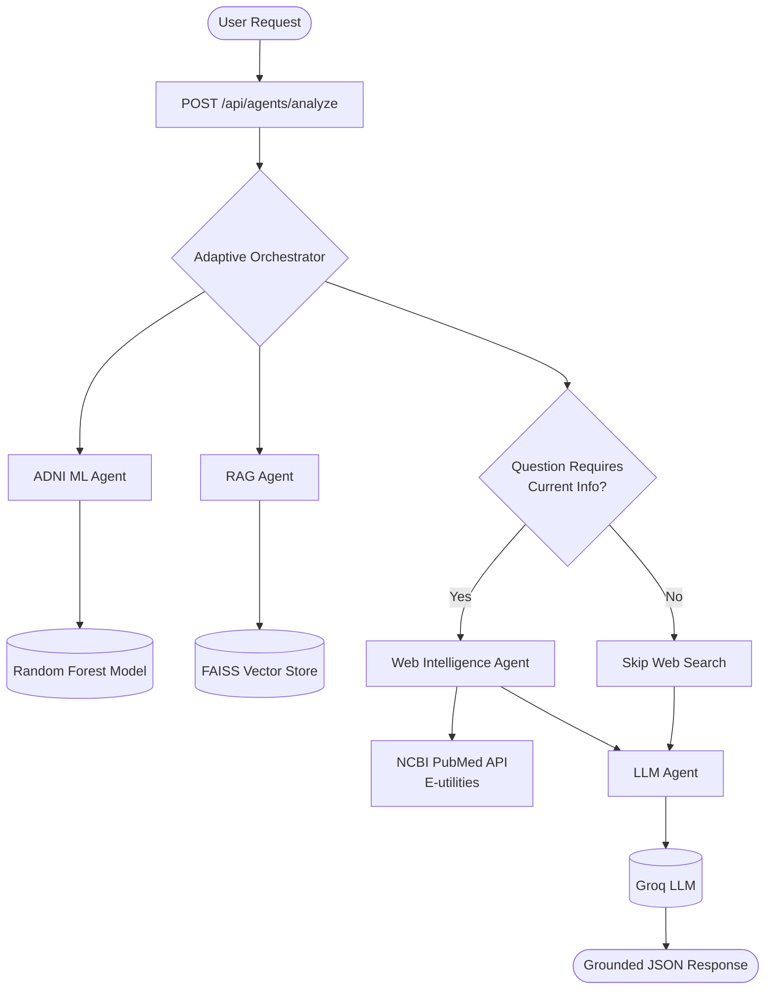

# Phase 8: Web Intelligence Architecture

## Overview
Phase 8 introduces the **Web Intelligence Agent** and **Adaptive Orchestration** to HealthSense AI. The goal is to supplement the strictly local, static Alzheimer's knowledge base (RAG) with current, authoritative external biomedical information (e.g., recent PubMed studies or guidelines) when the user's clinical question demands it.

## Architecture Diagram

## 1. Web Intelligence Agent
The `WebIntelligenceAgent` is responsible for fetching current biomedical research from external sources. It relies on the `PubMedWebIntelligenceService` which interfaces with the **NCBI PubMed E-utilities API**.

### Trusted Source Policy
To adhere strictly to the system's requirements, no generic web searches (like Google or DuckDuckGo) are performed. Instead, the agent exclusively queries **PubMed**, ensuring all retrieved snippets come from peer-reviewed biomedical literature, guidelines, or clinical trials.
- **Query Mechanism**: A focused query is sent to `esearch.fcgi` to retrieve recent article IDs.
- **Data Retrieval**: `esummary.fcgi` is used to fetch the title, journal source, publication date, and build a real DOI/PubMed URL.

## 2. Adaptive Orchestration
The Orchestrator (`backend/agents/orchestrator.py`) now features deterministic routing logic.
- **Route A (Current Info Needed)**: If the `clinical_question` contains keywords like *latest, recent, current, update, treatment, fda, approval, clinical trial*, the workflow routes to: `[ADNI ML Agent, RAG Agent, Web Intelligence Agent, LLM Agent]`.
- **Route B (No Current Info Needed)**: If the question does not contain these keywords, or if no question is provided, the Orchestrator skips the Web Agent to conserve resources and reduce noise: `[ADNI ML Agent, RAG Agent, LLM Agent]`.

## 3. LLM Context Separation
The prompt provided to the LLM has been updated to explicitly delineate:
1. `LOCAL BIOMEDICAL EVIDENCE`: Sourced from the FAISS RAG index.
2. `CURRENT WEB EVIDENCE`: Sourced from PubMed.

The LLM is strictly instructed to use this evidence without fabricating citations, URLs, or hallucinating medical advice. 

## 4. Error Handling and Degradation
- If PubMed is unreachable or times out, the `WebIntelligenceAgent` fails gracefully, returning an empty set of web results. The Orchestrator continues to the `LLMAgent`.
- Patient identifiers (PTID) are strictly excluded from being sent to PubMed.
- API keys are completely avoided for the Web Search, as the NCBI API is open and free.
